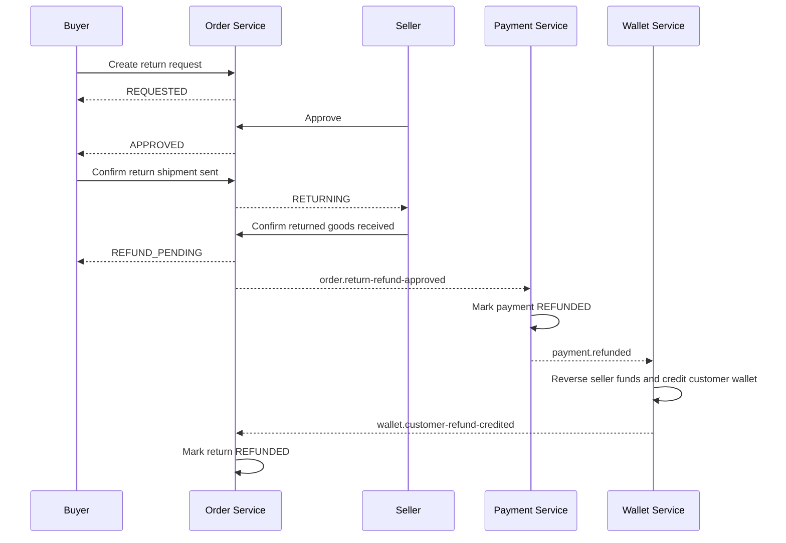

# Return and Refund Flow

Last updated: 2026-10-26

## Scope

The MVP supports a full-order return for a delivered order paid online. The customer must submit the request within seven days of delivery. Each order can have one return request and up to five HTTP(S) evidence links.

COD and partial-item refunds are intentionally outside this phase.

## State flow



The seller may reject a `REQUESTED` return with a note. The customer may cancel while the request is `REQUESTED` or `APPROVED`, before confirming shipment.

The visible state machine is:

```text
REQUESTED -> APPROVED -> RETURNING -> REFUND_PENDING -> REFUNDED
     |           |
     |           +-> CANCELLED (before shipment only)
     +-> REJECTED
     +-> CANCELLED (before approval)
```

`REFUNDED` is deliberately driven by `wallet.customer-refund-credited`, not only by `payment.refunded`. This prevents the return request from reporting success before the customer wallet ledger transaction commits.

## APIs

```text
POST  /api/v1/orders/{orderId}/returns
GET   /api/v1/orders/{orderId}/returns
GET   /api/v1/returns
PATCH /api/v1/returns/{returnId}/decision
PATCH /api/v1/returns/{returnId}/ship
PATCH /api/v1/returns/{returnId}/complete
PATCH /api/v1/returns/{returnId}/cancel
```

`decision` accepts `APPROVE` or `REJECT`. Seller ownership and customer ownership are derived from the JWT; IDs in request bodies are not trusted.

## Financial behavior

- Payment Service processes the refund idempotently from the order outbox event.
- Wallet Service consumes `payment.refunded` and applies a double-entry ledger reversal.
- If seller funds are still held or available, the amount is reversed there.
- If a payout already occurred, Wallet Service records seller debt according to the existing reversal policy.
- The refunded amount is credited to the customer's eMall wallet. A later bank payout remains a separate wallet operation.
- Order Service consumes `wallet.customer-refund-credited` and only then closes the request as `REFUNDED`.

## Local verification

1. Complete an online order and wait until it reaches `DELIVERED`.
2. Buyer opens `/orders/{orderId}/return` and submits a request.
3. Seller opens `/orders/returns` and approves it.
4. Buyer confirms “Tôi đã gửi trả hàng”.
5. Seller confirms returned goods received.
6. Wait for the Kafka outbox dispatchers.
7. Verify the return is `REFUNDED` and the customer wallet contains the refunded amount.

Useful checks:

```bash
docker compose logs --since=5m --no-color order-service payment-service wallet-service

docker compose exec -T postgres \
  psql -U eorder -d ecommerce_order \
  -c "SELECT return_number, order_id, status, refund_amount, responded_at, shipped_at, received_at, refunded_at FROM return_requests ORDER BY requested_at DESC LIMIT 10;"
```
