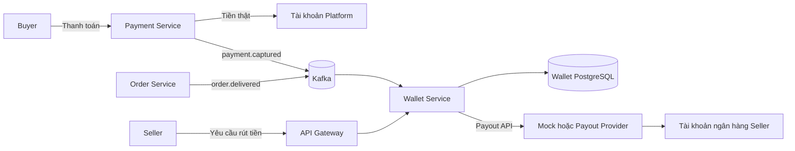

# Wallet Service Development Plan

Last updated: 2026-10-11

## 1. Mục tiêu

Xây dựng `wallet-service` cho phép:

- Ghi nhận tiền khách hàng đã thanh toán như một khoản Platform đang giữ hộ seller.
- Giữ tiền trong một khoảng thời gian sau khi đơn hàng được giao.
- Chuyển tiền sang số dư khả dụng khi hết thời gian giữ.
- Cho seller yêu cầu rút tiền về tài khoản ngân hàng.
- Tự động xử lý payout mà không cần admin duyệt và chuyển tiền thủ công trong luồng bình thường.
- Chạy mock hoàn chỉnh trước, sau đó mới bật chuyển tiền thật với số tiền nhỏ và giới hạn an toàn.

Chỉ thêm một microservice mới là `wallet-service`. Không tách thêm `admin-service` hoặc `payout-service` trong phạm vi đồ án.

## 2. Hiện trạng repository

Các thành phần có thể tái sử dụng:

- `payment-service`: payment lifecycle, provider interface, idempotency và outbox.
- `inventory-service`: Kafka consumer, `processed_events` và xử lý event at-least-once.
- `order-service`: phát `order.delivered` kèm `orderId`, `sellerId` và thông tin số tiền.
- `api-gateway`: proxy các API private tới microservice.
- Seller frontend đã có sẵn các trang:
  - `frontend/apps/seller/src/app/finance/balance/page.tsx`
  - `frontend/apps/seller/src/app/finance/bank-account/page.tsx`
  - `frontend/apps/seller/src/app/finance/revenue/page.tsx`

Các event đầu vào chính:

- `payment.captured`: xác nhận Platform đã nhận tiền.
- `payment.partially-refunded`, `payment.refunded`, `payment.chargeback`: đảo hoặc điều chỉnh khoản tiền seller được nhận.
- `order.delivered`: bắt đầu tính thời gian giữ tiền.

## 3. Kiến trúc tổng quát



`wallet-service` quản lý sổ cái và số tiền Platform đang nợ seller. Tiền thật vẫn nằm trong tài khoản Platform cho đến khi payout provider thực hiện chuyển khoản.

## 4. Quy tắc MVP

- Chỉ hỗ trợ `VND`.
- Chỉ ghi nhận payment online có trạng thái `CAPTURED`; COD chưa nằm trong MVP.
- Một order thuộc một seller, phù hợp model hiện tại.
- Phí nền tảng mặc định bằng `0` trong MVP.
- Thời gian giữ tiền cấu hình bằng environment variable:
  - Local/demo: 30-60 giây.
  - Production simulation: 7 ngày.
- Số tiền lưu bằng `BIGINT amount_minor`; không dùng `float64` trong wallet ledger.
- Mọi thay đổi số dư phải đi qua double-entry ledger.
- Seller ID lấy từ JWT, không tin `sellerId` trong request body.
- Payout thật mặc định tắt và chỉ được bật qua feature flag.
- Khi thử tiền thật, chỉ cho phép tài khoản trong allowlist và giới hạn số tiền nhỏ.

Luồng trạng thái tiền:

```text
HELD -> AVAILABLE -> PAYOUT_PENDING -> PAID_OUT
  \----------- refund/reversal -----------/
```

Luồng trạng thái payout:

```text
REQUESTED -> PROCESSING -> SUCCEEDED
                       \-> FAILED -> hoàn tiền về AVAILABLE
```

## 5. Data model dự kiến

Migration đầu tiên của `wallet-service` gồm:

- `wallets`: ví của seller theo currency.
- `ledger_accounts`: các tài khoản `PLATFORM_CLEARING`, `SELLER_HELD`, `SELLER_AVAILABLE`, `PAYOUT_PENDING`.
- `ledger_transactions`: thông tin một nghiệp vụ tài chính.
- `ledger_entries`: các dòng debit/credit; tổng entry của một transaction phải bằng 0.
- `fund_holds`: liên kết payment, order, seller, số tiền và `release_at`.
- `bank_accounts`: tài khoản nhận tiền của seller; số tài khoản được mã hóa và hiển thị dạng masked.
- `payouts`: yêu cầu rút tiền, provider reference và trạng thái xử lý.
- `idempotency_records`: chống tạo payout trùng.
- `processed_events`: chống xử lý Kafka event trùng.
- `outbox_events`: phát wallet/payout event an toàn sau database transaction.

## 6. API dự kiến

Seller API:

```text
GET  /api/v1/wallets/me
GET  /api/v1/wallets/me/transactions
GET  /api/v1/wallets/me/bank-account
PUT  /api/v1/wallets/me/bank-account
POST /api/v1/payouts
GET  /api/v1/payouts
GET  /api/v1/payouts/summary
GET  /api/v1/payouts/{id}
```

`POST /api/v1/payouts` bắt buộc có header `Idempotency-Key`.

Admin API chủ yếu phục vụ quan sát và xử lý sự cố:

```text
GET  /api/v1/admin/wallets
GET  /api/v1/admin/payouts
GET  /api/v1/admin/ledger-transactions
POST /api/v1/admin/wallets/{sellerId}/freeze
```

Admin không được cập nhật trực tiếp balance. Mọi adjustment sau này đều phải tạo ledger transaction có audit trail.

## 7. Kế hoạch triển khai trong 3 phase

### Phase 1 - Wallet core và ledger

Mục tiêu: tạo được service, sổ cái và luồng giữ/release tiền bằng event.

Công việc:

1. Tạo `services/wallet-service` theo cấu trúc Go service chuẩn:
   - `cmd/server`
   - `internal/auth`
   - `internal/config`
   - `internal/domain`
   - `internal/handler`
   - `internal/httpx`
   - `internal/middleware`
   - `internal/repository`
   - `internal/router`
   - `internal/service`
   - `internal/events`
   - `migrations`
2. Thêm config validation, health endpoints và graceful shutdown.
3. Tạo database schema cho wallet, ledger, hold, outbox và processed events.
4. Consume `payment.captured` để tạo khoản `HELD`.
5. Consume `order.delivered` và chạy release worker để chuyển `HELD -> AVAILABLE` khi đủ thời gian.
6. Xử lý event refund/chargeback bằng reversal ledger transaction.
7. Thêm API đọc balance và transaction history.

Checkpoint hoàn thành:

- Migration chạy lặp lại an toàn.
- Mỗi ledger transaction luôn cân bằng về 0.
- Event trùng không cộng tiền hai lần.
- Event đến sai thứ tự vẫn tạo kết quả đúng.
- Seller chỉ đọc được wallet của chính mình.
- Unit test và repository integration test pass.

### Phase 2 - Payout tự động và tích hợp hệ thống

Mục tiêu: seller rút tiền tự động hoàn chỉnh bằng mock provider và service chạy được trong local stack.

Công việc:

1. Xây `PayoutProvider` interface và `MockPayoutProvider`.
2. Thêm API quản lý bank account và tạo/list/get payout.
3. Khi seller yêu cầu rút:
   - Khóa wallet trong database transaction.
   - Kiểm tra số dư khả dụng.
   - Chuyển `AVAILABLE -> PAYOUT_PENDING`.
   - Tạo payout job để worker xử lý bên ngoài database transaction.
4. Payout worker gọi provider với idempotency key:
   - Thành công: `PAYOUT_PENDING -> PAID_OUT`.
   - Thất bại: hoàn tiền `PAYOUT_PENDING -> AVAILABLE`.
5. Thêm reconciliation worker cho payout bị treo hoặc mất callback.
6. Tích hợp repository:
   - Thêm database `ecommerce_wallet` vào PostgreSQL init.
   - Thêm `wallet-service` vào `docker-compose.yml`.
   - Thêm service URL và private proxy vào API Gateway.
   - Thêm wallet/payout topics và contracts vào `shared/kafka`.
   - Thêm metrics, log và health checks.

Checkpoint hoàn thành:

- `Idempotency-Key` giống nhau chỉ tạo một payout.
- Hai request đồng thời không làm số dư âm.
- Mock success và mock failure đều cập nhật ledger chính xác.
- Payout lỗi hoàn tiền về `AVAILABLE`.
- API Gateway proxy đúng và chặn request không có JWT.
- Local Docker stack chạy được end-to-end.

### Phase 3 - Seller frontend, payout thử và hoàn thiện demo

Mục tiêu: hoàn thiện trải nghiệm seller, kiểm thử end-to-end và chuẩn bị tùy chọn chuyển khoản thật với số tiền nhỏ.

Công việc:

1. Thay dữ liệu giả trên ba trang Finance bằng wallet API thật.
2. Bổ sung Seller BFF routes, API client và TypeScript types.
3. Hỗ trợ:
   - Xem `held`, `available`, `payoutPending`, `paidOut`.
   - Xem lịch sử giao dịch.
   - Thêm/cập nhật tài khoản ngân hàng.
   - Tạo và theo dõi yêu cầu rút tiền.
4. Viết end-to-end test cho toàn bộ luồng payment -> hold -> release -> payout.
5. Viết runbook và demo script.
6. Sau khi mock ổn định, thêm adapter payout thật phía sau các biến an toàn:
   - `PAYOUT_PROVIDER=mock|real`
   - `PAYOUT_ENABLED=false`
   - `PAYOUT_REAL_MONEY_ENABLED=false`
   - `PAYOUT_MAX_AMOUNT_VND`
   - `PAYOUT_DAILY_LIMIT_VND`
   - `PAYOUT_ALLOWED_BANK_ACCOUNTS`
7. Chỉ bật thử tiền thật cho tài khoản allowlist và số tiền nhỏ. Việc kích hoạt phải là thao tác cấu hình có chủ đích, không bật mặc định trong source code.

Checkpoint hoàn thành:

- Seller frontend không còn balance/bank account hardcode.
- Toàn bộ happy path và failure path pass.
- Log không chứa số tài khoản đầy đủ hoặc provider credential.
- Có kill switch để dừng payout ngay lập tức.
- Payout thật, nếu được bật, được đối soát thành công với ledger.
- Có tài liệu cách chạy và kịch bản demo cho giảng viên.

## 8. Acceptance tests bắt buộc

1. `payment.captured` tạo đúng một khoản `HELD`.
2. Kafka gửi lại event không cộng tiền lần hai.
3. `order.delivered` đến trước `payment.captured` vẫn xử lý được.
4. Chưa hết hold time thì seller không thể rút khoản tiền đó.
5. Hết hold time chuyển đúng `HELD -> AVAILABLE`.
6. Hai payout đồng thời không làm balance âm.
7. Cùng `Idempotency-Key` chỉ tạo một payout.
8. Provider thất bại hoàn tiền về `AVAILABLE`.
9. Provider thành công chuyển payout sang `PAID_OUT`.
10. Refund trước payout đảo ledger chính xác.
11. Refund sau payout tạo seller debt/negative adjustment và khóa payout tiếp theo.
12. Seller A không xem hoặc rút tiền của Seller B.

## 9. Quy trình giám sát thực hiện

Mỗi phase chỉ được đánh dấu hoàn thành khi có đủ:

1. Danh sách file đã thay đổi.
2. Migration và API/event contract liên quan.
3. Test cho happy path, validation, permission, duplicate và failure path.
4. Kết quả các lệnh kiểm tra phù hợp:

```bash
cd services/wallet-service && go test ./...
cd services/wallet-service && go vet ./...
cd services/api-gateway && go test ./...
npm --workspace @frontend/seller run build
docker compose config
```

5. Kiểm tra `git diff` để không làm thay đổi ngoài phạm vi.
6. Báo cáo rủi ro còn lại trước khi chuyển sang phase tiếp theo.

## 10. Trạng thái

| Phase | Trạng thái |
|---|---|
| Phase 1 - Wallet core và ledger | Hoàn tất (2026-10-11) |
| Phase 2 - Payout tự động và tích hợp | Hoàn tất (2026-10-11) |
| Phase 3 - Frontend, payout thử và demo | Hoàn tất phạm vi mock/demo (2026-10-12); payout thật chưa bật |

Bước tiếp theo tùy chọn: chọn một payout provider có sandbox và tài liệu chính thức trước khi triển khai adapter chuyển tiền thật. Luồng tiền thật tiếp tục bị khóa mặc định.

### Kết quả Phase 2

- Có `PayoutProvider` và mock provider cho `success`, `failure`, `pending`.
- Bank account được mã hóa AES-GCM, API chỉ trả số đã mask.
- Payout dùng `Idempotency-Key`, khóa wallet và double-entry ledger trong cùng transaction.
- Worker tự xử lý payout; reconciliation xử lý job `PROCESSING` bị treo.
- Provider lỗi nghiệp vụ hoàn tiền về `AVAILABLE`; lỗi tạm thời được retry.
- Refund làm seller âm tiền sẽ freeze wallet và chặn payout mới.
- Đã nối `ecommerce_wallet`, root Docker Compose, `wallet.events` và private API Gateway proxy.
- Có health/readiness, structured log và payout metrics tại `/metrics`.
- Đã kiểm tra migration chạy lặp, concurrent payout, seller isolation, success/failure ledger và Docker E2E.

### Kết quả Phase 3

- Ba trang Finance của seller đã dùng wallet API thật, có trạng thái loading, lỗi, rỗng và responsive trên desktop/mobile.
- Seller BFF chuyển tiếp JWT, pagination và `Idempotency-Key`; seller có thể xem số dư, lịch sử, quản lý tài khoản ngân hàng và theo dõi payout.
- Tài khoản ngân hàng chỉ hiển thị số đã mask; giao diện không giữ hoặc hiển thị lại số tài khoản đầy đủ.
- Yêu cầu rút tiền kiểm tra số dư, số tiền tối thiểu, trạng thái bank account/wallet và tự polling khi payout đang xử lý.
- Báo cáo doanh thu lấy từ ledger/payout thật, hỗ trợ tìm kiếm và xuất CSV.
- Có integration test cho luồng `payment -> hold -> release -> payout`, đồng thời kiểm tra số dư cuối và ledger cân bằng.
- Có runbook và script demo cho cả happy path và mock failure path.
- Đã render và kiểm tra trực quan ba trang Finance ở desktop cùng trang số dư ở mobile.
- Adapter tiền thật chưa được thêm vì chưa chọn provider/sandbox; `PAYOUT_ENABLED` vẫn là kill switch và local stack chỉ dùng mock provider.
